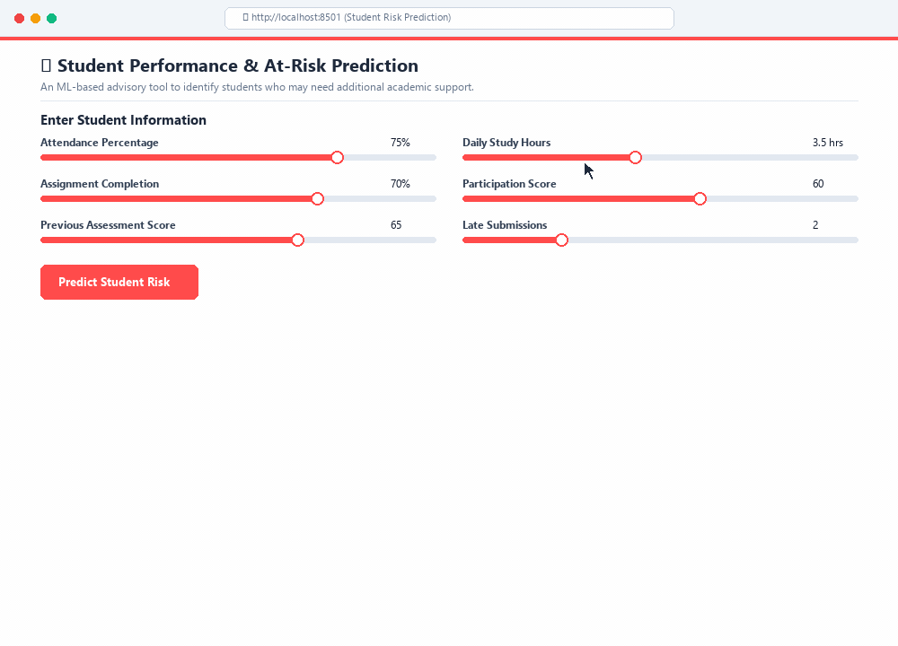

# Student Performance & At-Risk Prediction

An advisory machine learning decision-support tool designed for school management to identify students who may benefit from early academic intervention.

<p align="center">
  
</p>

---

## 1. Project Overview & Business Problem

In educational institutions, identifying struggling students before final assessments is vital for timely academic support. This project implements a predictive decision-support system that estimates the likelihood of a student falling into an academic at-risk category using behavioral and historical performance signals available prior to the assessment.

> **Advisory Use Policy**: This tool is designed strictly for early academic guidance and intervention planning. Predictions are probabilistic advisory indicators and must **never** be used for automated punitive actions, grading, or disciplinary decisions without human review.

---

## 2. Dataset Description & Generation

The model is trained on a controlled, privacy-preserving **synthetic educational dataset** (`data/processed/student_performance_synthetic.csv`) containing 5,000 student records generated with a fixed random seed (`seed=42`) for 100% reproducibility.

*(Note: The active model is trained on the synthetic dataset to ensure 100% reproducible behavioral benchmarking without exposing private or restricted student records.)*

### Data Generating Process
Student attributes are generated using a latent engagement factor combined with normal and binomial distributions:
- **Latent Engagement Factor**: $z \sim \mathcal{N}(0, 1)$ representing student motivation and study habits.
- **Pre-Outcome Features**:
  1. `attendance_percentage`: Lecture and tutorial attendance percentage (range: 0–100%).
  2. `assignment_completion`: Percentage of coursework assignments completed (range: 0–100%).
  3. `previous_score`: Score achieved on prior assessments (range: 0–100%).
  4. `study_hours`: Average self-reported daily study hours (range: 0.0–8.0 hrs).
  5. `participation_score`: Score evaluating classroom and LMS participation (range: 0–100%).
  6. `late_submissions`: Number of assignments submitted after deadline (range: 0–8).
- **Target Outcome (`at_risk`)**:
  - The expected future assessment score is computed using weighted academic indicators plus Gaussian noise.
  - A student is categorized as **At Risk** (`at_risk = 1`) if their future assessment score falls below **40%**, and **Not At Risk** (`at_risk = 0`) otherwise.
  - **Class Balance**: 84.9% Not At Risk (4,245 students) vs. 15.1% At Risk (755 students), reflecting realistic academic failure rates.

---

## 3. Machine Learning Pipeline

### Models Evaluated
Three candidate models were evaluated on an 80/20 stratified split ($N_{\text{test}} = 1,000$):
1. **Logistic Regression** (Standardized Baseline)
2. **Gradient Boosting Classifier**
3. **Random Forest Classifier** (`class_weight='balanced'`)

### Model Selection & Decision Threshold
- In educational intervention, **False Negatives** (missing a student who needs help) carry high risk, whereas **False Positives** (offering support to a student who passes) carry low cost.
- The **Random Forest** model with balanced class weights was selected, and its classification decision threshold was tuned on a validation set to **0.35** (down from the default 0.50).
- **Test Performance (Threshold = 0.35)**:
  - **Recall**: **90.07%** (catches 136 of 151 at-risk students; false negatives reduced from 51 to 15)
  - **Precision**: **46.58%**
  - **Accuracy**: **82.90%**
  - **F1-Score**: **0.6140**

The trained model bundle is serialized as `models/student_risk_model.joblib`.

---

## 4. Project Structure

```
risk-pred/
├── .gitignore                      # Git exclusion rules (tracks models and processed data)
├── app.py                          # Interactive Streamlit advisory dashboard
├── README.md                       # Project documentation
├── requirements.txt                # Pinned project dependencies
├── data/
│   ├── Student prediction info.docx# Assignment brief & evaluation rubric
│   ├── processed/
│   │   ├── .gitkeep
│   │   └── student_performance_synthetic.csv # Processed dataset (5,000 records)
│   └── raw/
│       └── .gitkeep                # Raw data placeholder
├── models/
│   ├── .gitkeep
│   └── student_risk_model.joblib   # Trained model artifact (threshold 0.35)
├── notebooks/
│   ├── model_training.ipynb        # Data generation, EDA, model training & export
│   └── load_model.ipynb            # Model loading verification & inference check
├── reports/
│   ├── .gitkeep                    # Generated evaluation reports
│   └── dashboard_demo.gif          # Animated demonstration of the Streamlit dashboard
├── src/
│   └── .gitkeep                    # Modular source code
└── tests/                          # Automated test suite
```

---

## 5. Installation & Setup

### Prerequisites
- Python 3.10 or 3.11 installed.

### Setup Instructions
1. Clone the repository and navigate into the project directory:
   ```bash
   cd risk-pred
   ```

2. Create and activate a virtual environment:
   ```bash
   # Windows (PowerShell)
   python -m venv venv
   .\venv\Scripts\Activate.ps1
   ```

3. Install dependencies:
   ```bash
   pip install -r requirements.txt
   ```

---

## 6. Running the Application

Launch the Streamlit interactive dashboard:
```bash
streamlit run app.py
```

The application opens locally in your default web browser (typically at `http://localhost:8501`). Enter student attendance, scores, and study habits to inspect real-time risk predictions, advisory probability, and recommended support actions.

---

## 7. Ethical Considerations & Limitations

- **Synthetic Data Representation**: Model weights reflect synthetic data distributions and require local recalibration before deployment on real-world school cohorts.
- **Uncertainty & Human-in-the-Loop**: Predictions are statistical estimates. Every prediction should be validated by academic advisors who take individual context, health, and personal circumstances into account.
- **No Protected Attributes**: The model intentionally excludes demographic, socioeconomic, and protected attributes to avoid introducing algorithmic bias.
